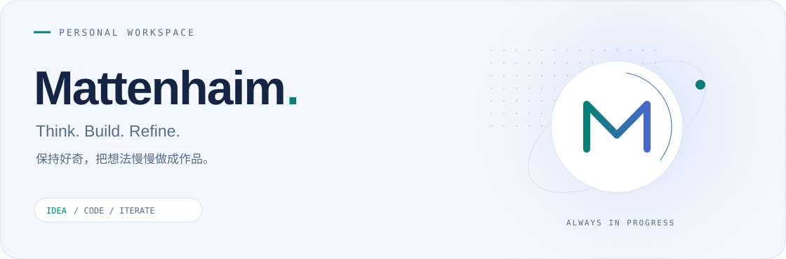

<picture>
  <source media="(prefers-color-scheme: dark)" srcset="assets/header-dark.svg" />
  <source media="(prefers-color-scheme: light)" srcset="assets/header-light.svg" />
  
</picture>

  <a href="https://github.com/Mattenhaim?tab=repositories">代码仓库 · Repositories</a>
  &nbsp; / &nbsp;
  <a href="https://github.com/Mattenhaim?tab=stars">灵感收藏 · Stars</a>

### 你好，我是 Mattenhaim 👋

欢迎来到我的个人工作台。这里记录想法，也留下把想法变成现实的过程。

> 从一个小问题开始，做一点有用的东西，再让它变得更好。

<table>
  <tr>
    <td width="33%" valign="top"><strong>01 / THINK</strong>  保持好奇 提出问题，寻找值得尝试的方向。</td>
    <td width="33%" valign="top"><strong>02 / BUILD</strong>  动手实现 让想法走出笔记，变成可用的作品。</td>
    <td width="33%" valign="top"><strong>03 / REFINE</strong>  持续打磨 在一次次迭代里，把细节做好。</td>
  </tr>
</table>

### 一点一滴 · Contribution trail

<!-- CONTRIBUTIONS:START -->
贡献轨迹会在主页仓库首次运行动画工作流后展示。
<!-- CONTRIBUTIONS:END -->

Small steps. Thoughtful work. Keep going.

